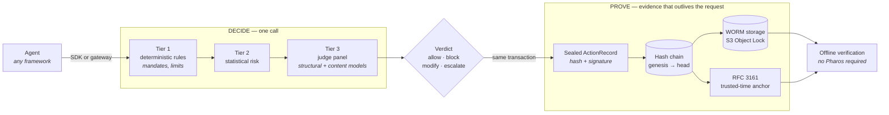

<p align="center">
  
</p>

<h1 align="center">Pharos</h1>

<p align="center"><strong>Real-time policy verdicts for AI agents, with signed, hash-chained evidence of every decision.</strong><br>
<em>Pharos decides. Pharos proves.</em></p>

<p align="center">
  <a href="https://github.com/Bobcatsfan33/Pharos/actions/workflows/ci.yml"></a>
  <a href="https://www.npmjs.com/package/@getpharos/sdk"></a>
  <a href="https://pypi.org/project/getpharos/"></a>
  <a href="LICENSE"></a>
  <a href="docs/roadmap.md"></a>
</p>

---

When an agent is about to do something consequential — move money, send PHI, push to a
protected branch, delete a record — Pharos answers two questions in one call.

**Can it?** A verdict — `allow`, `block`, `modify` or `escalate` — citing the rule clause it
relied on.
**What happened?** A signed, hash-chained record binding the action to its mandate, its
verdict and its blast radius, written in the *same transaction* and verifiable by anyone,
offline, later.

One pipeline, two outputs. An action can never be governed without being recorded, or
recorded without its governing context.

## Quickstart

Three governed actions and a verified chain, on your machine, in about a minute. No cloud
account, no API key.

```bash
git clone https://github.com/Bobcatsfan33/Pharos.git && cd Pharos
pnpm install && cp .env.example .env
pnpm infra:up              # Postgres + Redis + MinIO (S3 WORM) via docker compose
pnpm demo                  # the funds-transfer story above
pnpm verify:bundle evidence-bundle.json   # verify it with no Pharos running
```

Prerequisites: Node ≥ 22, pnpm 10, Docker. First run spends most of its time pulling three
images; the commands themselves take seconds. The full walkthrough — including tampering with
the bundle and watching it fail — is in [docs/demo.md](docs/demo.md).

## Use it from your agent

<table>
<tr><th>TypeScript</th><th>Python</th></tr>
<tr><td>

```ts
import { PharosClient } from "@getpharos/sdk";

const pharos = new PharosClient({ baseUrl, apiKey });
const { verdict, record } = await pharos.submit({
  tenantId: "acme",
  action: { type: "payment.transfer",
            agentId: "treasury-bot",
            payload: { amount: 30_000 } },
  liability: {
    mandate: null, oversightMode: "autonomous",
    blastRadius: { financialAmount: 30_000,
                   currency: "USD",
                   reversibility: "irreversible" },
    modelMetadata: null,
  },
});
if (verdict.decision === "block")
  throw new Error(verdict.ruleCitations[0]?.description);
// record.seal.contentHash is permanent, signed evidence.
```

</td><td>

```python
from pharos_sdk import PharosClient

pharos = PharosClient(base_url=base_url, api_key=api_key)
result = pharos.submit(
    tenantId="acme",
    action={"type": "payment.transfer",
            "agentId": "treasury-bot",
            "payload": {"amount": 30000}},
    liability={"mandate": None,
               "oversightMode": "autonomous",
               "blastRadius": {"financialAmount": 30000,
                               "currency": "USD",
                               "reversibility": "irreversible"},
               "modelMetadata": None},
)
if result["verdict"]["decision"] == "block":
    raise RuntimeError(
        result["verdict"]["ruleCitations"][0]["description"])
```

</td></tr>
</table>

Both SDKs honour the verdict deadline, retry transient failures, and apply a **local
fail-mode** when Pharos is unreachable: reversible work fails open, irreversible work fails
closed.

**Works with**

| | |
|---|---|
| Frameworks | LangChain / LangGraph · OpenAI Agents · Anthropic SDK · CrewAI · Microsoft Agent Framework — one wrap call each, one conformance contract ([docs](docs/sdks-and-integration.md)) |
| MCP and tools | Governed MCP tool calls, credential grants and governed connector effects ([docs](docs/capability-platform.md)) |
| No code at all | An HTTP egress gateway that governs an agent importing nothing ([docs](docs/sdks-and-integration.md#zero-code-gateway)) |
| Policy | Citation-level packs (FINRA, HIPAA) as JSON, a constrained-grammar compiler, OPA and Cedar interchange, signed policy bundles ([docs](docs/regulation-packs-and-policy.md)) |
| Standards | The open [PDP specification](docs/spec/pdp-v1.md) with a conformance suite and published [JSON Schema](packages/pdp-spec/schema/pdp-v1.schema.json) |
| Execution | **Pharos Runtime** — durable, governed execution in Python: every step gets a verdict, escalation is a zero-compute pause, runs resume after a crash and replay byte-identically ([docs](docs/runtime.md)) |

## How it works



- **Decide.** A deterministic Tier 1 (mandates, limits, packs) short-circuits most actions.
  Tier 2 scores statistical risk. Tier 3 is a panel of typed judges — a model-free structural
  judge on every action, content models only for the action types their pack binds to — run
  concurrently under a hard deadline. On a deadline breach or a dependency fault, reversible
  actions fail open into async review and irreversible actions fail closed to a human.
- **Prove.** The verdict and the record come out of one database transaction. Records are
  canonicalised, hashed, signed (local Ed25519 in development; AWS KMS, Vault Transit, Azure
  Key Vault or GCP KMS through one `SigningProvider` interface), chained per tenant and
  written to WORM storage. Chain heads are anchored to an RFC 3161 timestamp authority.
- **Verify.** `pnpm verify:bundle` re-derives every hash, checks every signature against the
  published keyset, walks the chain and checks the anchor using `@pharos/core` alone — no
  database, no signer, no network.

[docs/architecture.md](docs/architecture.md) has the full map and the extension points.

## Status

Pharos is not a finished product, and says so in its own repository. What is listed as
working is covered by tests that run against real Postgres, Redis and MinIO; CI fails the
build if an integration test is skipped rather than run.

| | |
|---|---|
| **Works today, tested** | Verdict cascade · structural judge, routing and the parallel Tier-3 panel · sealing · hash chain · WORM · RFC 3161 anchoring · offline verification · TS and Python SDKs · framework middlewares · zero-code gateway · OPA/Cedar interchange · signed policy bundles · MCP and connector governance · approval policy · assurance promotion and rollback · Pharos Runtime |
| **Judges** | The content judges on the default local path are linear bag-of-words classifiers: fast, deterministic and defeated by paraphrase. Transformer judges are served and requalified on ONNX Runtime 1.30 but remain **restricted pre-production**; their [model cards](docs/model-cards/production-judges.md) list the evidence still missing. No judge is promoted. |
| **Latency** | Judge path for an action with no applicable model: 0.074 ms p99; the three-model tier runs in max, not sum. End to end with all three ONNX judges on a developer laptop: 597 ms p99 at ~8 verdicts/s, so the 1,000 verdicts/s production-topology gate is open. [Benchmarks](docs/benchmarks/latency.md). |
| **Every known gap** | [docs/LIMITATIONS.md](docs/LIMITATIONS.md) — the list is expected to shrink. |
| **What is next** | [docs/roadmap.md](docs/roadmap.md) |

## Repository

```
packages/core          ActionRecord schema, hashing, sealing, chain verify, signing-provider registry
packages/cascade       the tiered verdict engine and judge panel
packages/judge         structural judge, linear and ONNX content judges, judge-provider registry
packages/policy        rule evaluator, compiler, OPA/Cedar interop, packs/*.json
packages/evidence      claims packs, exports, TSA-provider registry (local, RFC 3161)
packages/storage       Postgres + S3 WORM + Redis — the transactional write path
packages/pdp-spec      the open PDP contract: zod schemas, JSON Schema, conformance suite
packages/sdk-ts        TypeScript SDK             sdks/python        Python SDK
packages/middleware    framework adapters         packages/connectors MCP + governed effects
services/api           Fastify ingestion API      services/gateway   zero-code egress gateway
runtime/python         Pharos Runtime (durable, governed execution)
apps/console           Next.js console
deploy/                Docker Compose and Helm — see deploy/INSTALL.md
```

## Docs

| | |
|---|---|
| [Architecture](docs/architecture.md) | How the pieces fit together, and where a new one goes |
| [Demo walkthrough](docs/demo.md) | The funds-transfer story, end to end, including tampering |
| [Decision cascade](docs/decision-cascade.md) | Tiers, the judge panel, routing, deadlines, fail-modes |
| [Evidence and sealing](docs/evidence-seal.md) | Chain, anchoring, redaction, claims packs |
| [Offline verification](docs/external-verification.md) | Verify a bundle with no Pharos infrastructure |
| [SDKs and integration](docs/sdks-and-integration.md) | SDKs, middlewares, the gateway |
| [Policy and packs](docs/regulation-packs-and-policy.md) | Packs, the compiler, lifecycle, interop |
| [Pharos Runtime](docs/runtime.md) | Durable, governed execution |
| [PDP specification](docs/spec/pdp-v1.md) | The open contract and conformance suite |
| [Schema](docs/schema-v1.md) | The `ActionRecord` event |
| [Threat model](docs/security/THREAT_MODEL.md) | STRIDE analysis and the accepted-risk register |
| [Operations](docs/operations.md) · [Install](deploy/INSTALL.md) | Running it for real |
| [Limitations](docs/LIMITATIONS.md) | Everything that does not yet work as a buyer would want |

## Contributing

Good first issues are labelled and scoped with acceptance criteria. Adding a signing or
trusted-time backend, a judge provider, a policy pack or a framework adapter is one new file
plus one registration — [CONTRIBUTING.md](CONTRIBUTING.md) says where each goes and which
registry it uses. The house rules: DCO sign-off, a changeset for publishable packages,
integration tests that run rather than skip, and docs that never claim what the code cannot
back. Apache-2.0; the [open-core boundary](docs/adr/0001-open-core-boundary.md) relicenses
nothing. Be decent — see the [Code of Conduct](CODE_OF_CONDUCT.md).

---

<p align="center"><em>Pharos decides. Pharos proves.</em></p>
