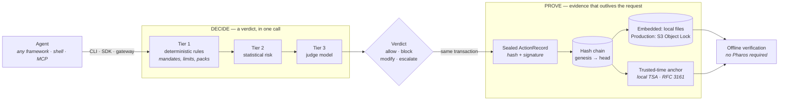

# Pharos

**Your coding agent has shell, git, and MCP access. Pharos gives every tool call a policy verdict and a signed, hash-chained record — before it runs.**

```bash
npx @getpharos/cli init && npx @getpharos/cli demo
```

<p align="center">
  
</p>

Three governed actions, each with the rule it cited, each sealed into a local chain; the chain
verified genesis→head; an `evidence-bundle.json` anyone can check **offline, with no Pharos
running** — and a tampered bundle failing. Nothing installed but Node ≥ 22.13, no Docker, no
account, no API key. Measured: **1.2 s** from `npm install` of the tarball to the verified chain
([transcript](docs/adoption/transcripts/cli-init-demo.txt), [how it was measured](docs/adoption/01-phase-a-results.md)).

```bash
npx @getpharos/cli run -- git push --force origin main   # BLOCK    cited cas-git-force-push-protected · exit 2
npx @getpharos/cli run -- rm -rf build                   # ESCALATE held for a human, cited cas-rm-recursive · exit 3
npx @getpharos/cli run -- pnpm test                      # ALLOW    runs — and the record was sealed first
npx @getpharos/cli verify evidence-bundle.json           # every hash, signature, link and time anchor; exit 0 / 1
```

[](LICENSE)
[](https://github.com/Bobcatsfan33/Pharos/actions/workflows/ci.yml)
[](https://www.npmjs.com/package/@getpharos/sdk)
[](https://pypi.org/project/getpharos/)

**Works with** · [LangChain / LangGraph](docs/sdks-and-integration.md#framework-middlewares-one-conformance-contract) · [OpenAI Agents SDK](docs/sdks-and-integration.md#framework-middlewares-one-conformance-contract) · [Anthropic SDK](docs/sdks-and-integration.md#framework-middlewares-one-conformance-contract) · [CrewAI](docs/sdks-and-integration.md#framework-middlewares-one-conformance-contract) · [Microsoft Agent Framework](docs/sdks-and-integration.md#framework-middlewares-one-conformance-contract) · [any HTTP agent, zero code](docs/sdks-and-integration.md#zero-code-gateway) · [`pharos serve` + the SDKs](packages/cli/README.md) · Claude Code hook and MCP proxy: *next* ([Phase A results and what is deferred](docs/adoption/01-phase-a-results.md))

---

## What it is

When an AI agent is about to do something consequential — run a command, push a branch, move
money, send PHI — Pharos answers two questions in one call. **Can it?** A policy verdict
(allow, block, modify, escalate) citing the specific rule it relied on. **What happened?** A
signed, hash-chained evidence record binding that action to its mandate, its verdict, and its
blast radius — written in the **same transaction** as the verdict and verifiable by anyone,
offline, later.

One pipeline, two outputs: **an agent action can never be governed without being recorded, or
recorded without its governing context.** Guardrail libraries block bad output but leave no
durable trail; governance tooling documents policy but never touches runtime. Pharos closes the
loop — the event that *decides* is the one that *proves*.

**Two storage postures, one pipeline.** The `npx` path above runs the **embedded** backend:
SQLite plus content-addressed record files, tamper-evident and offline-verifiable, **not
WORM** — the honest label is in [LIMITATIONS §8](docs/LIMITATIONS.md#8-embedded-mode-sqlite--local-files-is-an-on-ramp-not-a-retention-tier).
The production backend is Postgres (row-level security) + **S3 Object Lock** (COMPLIANCE-mode
WORM) + Redis + AWS KMS + RFC 3161 trusted time, selected by one variable
(`PHAROS_STORAGE_BACKEND`); both run the same storage conformance suite and the same
verifier.



## The production stack, locally

The full path — Postgres, Redis, MinIO with Object Lock, the KMS emulator — in Docker:

```bash
git clone https://github.com/Bobcatsfan33/Pharos.git && cd Pharos
pnpm install && cp .env.example .env
pnpm infra:up          # Postgres + Redis + MinIO (S3 WORM) + KMS emulator via docker compose
pnpm demo:durability   # three verdicts sealed to Postgres + WORM
pnpm demo:durability --verify   # cold restart, chain verifies genesis→head
pnpm demo              # the funds-transfer story: escalate, mandate, allow, anchor, bundle
pnpm verify:bundle evidence-bundle.json
```

The commands take seconds once the images are pulled; the pull is the slow part. The
walkthrough, including **tampering with the bundle and watching it fail**, is in
[docs/demo.md](docs/demo.md).

## Use it from your agent

```bash
npm install @getpharos/sdk        # TypeScript
pip install getpharos             # Python (import pharos_sdk)
npx @getpharos/cli serve          # the API over embedded storage on 127.0.0.1:4000, with an API key
```

```typescript
import { PharosClient } from "@getpharos/sdk";

const pharos = new PharosClient({ baseUrl, apiKey });

const { verdict, record } = await pharos.submit({
  tenantId: "acme",
  action: { type: "payment.transfer", agentId: "treasury-bot", payload: { amount: 30_000 } },
  liability: {
    mandate: null,
    oversightMode: "autonomous",
    blastRadius: { financialAmount: 30_000, currency: "USD", reversibility: "irreversible" },
    modelMetadata: null,
  },
});

if (verdict.decision === "block") throw new Error(verdict.ruleCitations[0]?.description);
// record.seal.contentHash is now permanent, signed evidence.
```

```python
from pharos_sdk import PharosClient

pharos = PharosClient(base_url=base_url, api_key=api_key)

result = pharos.submit(
    tenantId="acme",
    action={"type": "payment.transfer", "agentId": "treasury-bot",
            "payload": {"amount": 30000}},
    liability={"mandate": None, "oversightMode": "autonomous",
               "blastRadius": {"financialAmount": 30000, "currency": "USD",
                               "reversibility": "irreversible"},
               "modelMetadata": None},
)

if result["verdict"]["decision"] == "block":
    raise RuntimeError(result["verdict"]["ruleCitations"][0]["description"])
```

Both SDKs are deadline-aware, retry transient failures, and apply a **local fail-mode** when
Pharos is unreachable: reversible work fails open, irreversible work fails closed. Framework
middlewares (LangChain/LangGraph, OpenAI Agents, Anthropic SDK, CrewAI, MS Agent Framework)
share one conformance contract, and a zero-code HTTP gateway governs agents that import
nothing at all. See **[docs/sdks-and-integration.md](docs/sdks-and-integration.md)**.

### Pharos Runtime: governed execution included

Pharos now ships its durable Python runtime in this monorepo under
[`runtime/python`](runtime/python). It submits every runnable step through `/v1/actions`,
writes the sealed evidence binding into its append-only execution log, and maps escalation
to a zero-compute durable pause. After review, the same run resumes with a stable replay-safe
claim identity. The control plane and runtime remain independently scalable while sharing
one product, release boundary, and end-to-end CI proof.

```bash
python3 -m pip install -e "runtime/python[viewer]"
pharos run --mock runtime/python/examples/pharos_governed.py --run-id governed-demo
```

The legacy `keel` command remains available for compatibility. See the
[Pharos Runtime contract and quickstart](docs/runtime.md).

## Status — what is and isn't proven

Pharos is **not a finished product, and its own readiness manifest says so.** That manifest
is machine-checked in CI and currently reads `decision: not-approved` with 6 open blocking
gates. It ships published rather than hidden, because a system whose pitch is *evidence*
should be willing to be evidence about itself.

| | |
|---|---|
| **Works today, tested** | Verdict cascade · sealing · hash chain · WORM · offline verification · TS + Python SDKs · framework middlewares · zero-code gateway · OPA/Cedar interchange · signed policy bundles · MCP/tool governance · governed connectors · approval policy · causal evidence graph · assurance promotion/rollback · technical control mappings · open governed-action protocol |
| **Test suite** | 545 control-plane tests plus the complete runtime and Python SDK suites—run against **real** Postgres / Redis / MinIO. CI fails the build if integration tests are skipped rather than run |
| **Not production-approved** | [`docs/enterprise-readiness.json`](docs/enterprise-readiness.json) · [`docs/procurement-readiness.md`](docs/procurement-readiness.md) |
| **Every known gap** | [`docs/LIMITATIONS.md`](docs/LIMITATIONS.md) |

**On the judges, plainly.** The Tier-3 judges on the default local path are **linear
bag-of-words classifiers**. They are the honest demo path — fast, deterministic, easy to
reason about, and defeated by paraphrase. The transformer judges are wired and served but
remain **restricted pre-production**: their
[model cards](docs/model-cards/production-judges.md) list the adversarial-efficacy,
calibration, and independent-validation evidence still missing. **No judge is promoted or
marketed as production-ready.** The deterministic Tier 1 and statistical Tier 2 carry the
load a demo actually exercises.

**On latency.** The old p99 3.7 ms / ~5,400 verdicts-per-second linear-model headline has been
retired. The benchmark now loads all three ONNX judges by default. A current Apple-M2 engineering
run stayed below 800 ms p99 at concurrency 2 but achieved only about 8 verdicts/second, so the
1,000 verdicts/second production-topology gate remains open. See
[`docs/benchmarks/latency.md`](docs/benchmarks/latency.md).

## How it's built

| | |
|---|---|
| Operational state | Postgres — policies, mandates, queues, tenants; RLS-isolated under a `NOBYPASSRLS` role |
| Evidence chain | WORM object storage (S3 Object Lock), hash-chained and continuously verified |
| Verdict cache | Redis, deadline-bound |
| Signing | Pluggable `SigningProvider` — local Ed25519, AWS KMS P-256, and remote BYOK/HYOK transports for Vault Transit, Azure Key Vault, and GCP KMS, with rotation and chain continuity |
| Deployment | Docker Compose or Helm — see [deploy/INSTALL.md](deploy/INSTALL.md) |

```
packages/core        ActionRecord schema, hashing, sealing, chain verify, KMS signing
packages/cascade     the tiered verdict engine
packages/connectors  MCP registry, credential grants, governed effects, plugin conformance
packages/devkit      policy simulation/diff, fixture sanitation, environment doctor
packages/storage     Postgres + S3 WORM + Redis; the transactional write path
packages/sdk-ts      TypeScript SDK          sdks/python   Python SDK
packages/middleware  framework adapters
services/api         Fastify ingestion API   services/gateway  zero-code egress gateway
apps/console         Next.js console
```

## Docs

| | |
|---|---|
| [Architecture](docs/architecture.md) | How the pieces fit together |
| [Capability platform](docs/capability-platform.md) | Policy interop, MCP, connectors, approvals, assurance, compliance, and the open protocol |
| [Demo walkthrough](docs/demo.md) | The funds-transfer story, end to end |
| [Decision cascade](docs/decision-cascade.md) | Tiers, deadlines, fail-modes |
| [Evidence & sealing](docs/evidence-seal.md) | Chain, anchoring, redaction, claims packs |
| [Offline verification](docs/external-verification.md) | Verify a bundle with no Pharos infrastructure |
| [Schema](docs/schema-v1.md) | The `ActionRecord` event |
| [Threat model](docs/security/THREAT_MODEL.md) | STRIDE analysis and the accepted-risk register |
| [Limitations](docs/LIMITATIONS.md) | Everything that does not yet work as a buyer would want |
| [Sprint history](docs/status.md) | What was built, sprint by sprint |
| [Contributing](CONTRIBUTING.md) | Setup, the review bar, and how this repo is run |

## Contributing

Good first issues are labelled and scoped with acceptance criteria. The house rules — DCO
sign-off, a changeset for publishable packages, integration tests that **run** rather than
skip, and rendering configuration rather than reading it — are in
**[CONTRIBUTING.md](CONTRIBUTING.md)**. Apache-2.0; the
[open-core boundary](docs/adr/0001-open-core-boundary.md) is a proposal that relicenses
nothing. Be decent — see the [Code of Conduct](CODE_OF_CONDUCT.md).

---

*Pharos decides. Pharos proves.*
